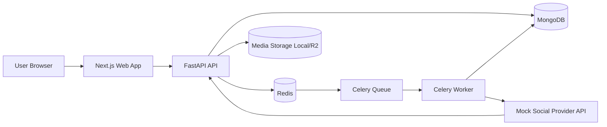

# System Overview

## Goals

- Support teams with workspace-scoped social scheduling
- Keep API and worker concerns separated
- Ensure status consistency between UI and async processing
- Make failures visible, recoverable, and auditable

## High-Level Architecture

## Service Responsibilities

### Next.js Web App

- Authentication screens and workspace switcher
- Post composer and media upload UX
- Scheduler UI with timezone support
- Dashboard status views for draft/scheduled/published/failed
- Polling (MVP) for job status updates

### FastAPI API

- Auth and refresh token rotation
- Workspace membership and role checks
- CRUD for posts and schedules
- Media upload URL generation and validation
- Queue enqueue on schedule operations via Celery
- Webhook endpoint for provider callbacks
- Job status polling endpoint

### Celery Worker

- Consumes tasks from Redis queue
- Executes publish attempts to provider adapter
- Handles retry with exponential backoff (built-in)
- Persists attempt log and post/job status transitions
- Supports task routing and priority queues
- Scales horizontally (run multiple workers)

### Celery Beat Scheduler

- Runs periodic/scheduled tasks
- Enqueues tasks at defined intervals
- Manages task scheduling for delayed publishes

### MongoDB

- Flexible post payloads by provider and media type
- Workspace, users, memberships, provider accounts
- Publish jobs and attempt audit trail

### Redis

- Delayed/scheduled jobs
- Retry metadata and dead-letter handling
- Optional short-lived caching

## Primary Data Flow

1. User composes a draft post.
2. User schedules the post with timezone-aware datetime.
3. API validates permissions and post readiness.
4. API writes scheduled state in MongoDB.
5. API enqueues delayed job in Redis.
6. Worker consumes job at due time.
7. Worker calls mock provider and updates final status.
8. UI polls status endpoint and refreshes state.

## Non-Functional Requirements

- Idempotent job processing by job ID
- At-least-once processing with safe deduplication
- P95 schedule API latency under 300ms at baseline load
- No plaintext secret storage
- Full audit trail for publish attempts
