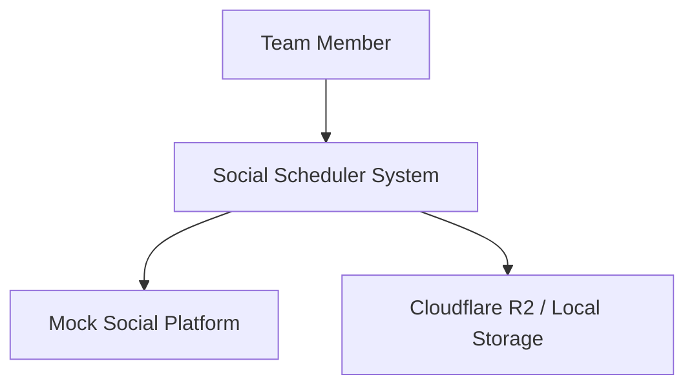
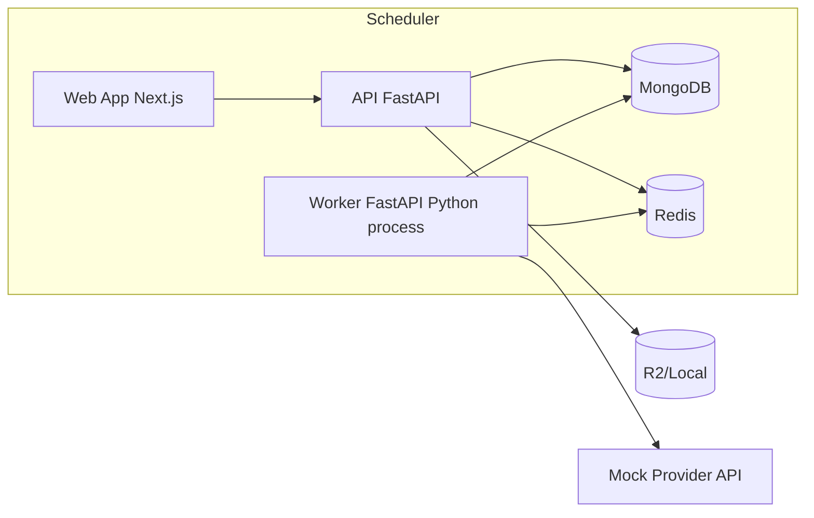
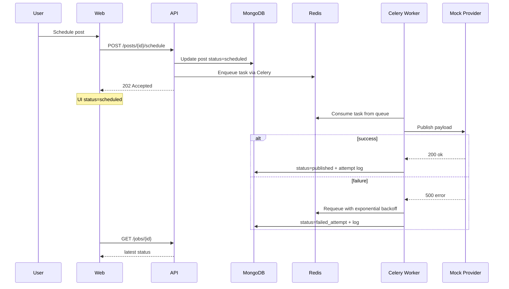
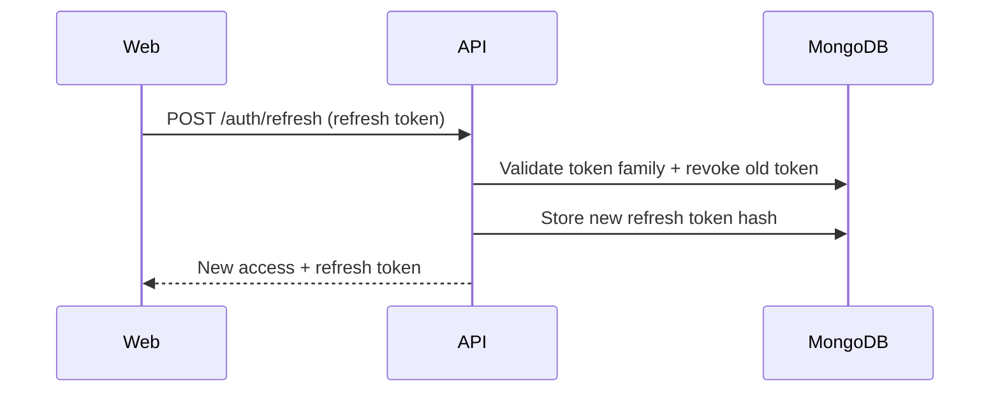

# C4 and Sequence Views

## C4 Context

## C4 Container

## Sequence: Schedule to Publish

## Celery Architecture Integration

## Sequence: Refresh Token Rotation

## Failure Handling Model

- Attempt count tracked on each publish job
- Retry delay increases exponentially
- Max attempts transitions job to terminal failed
- Dead-letter list keeps permanent failures for manual action
