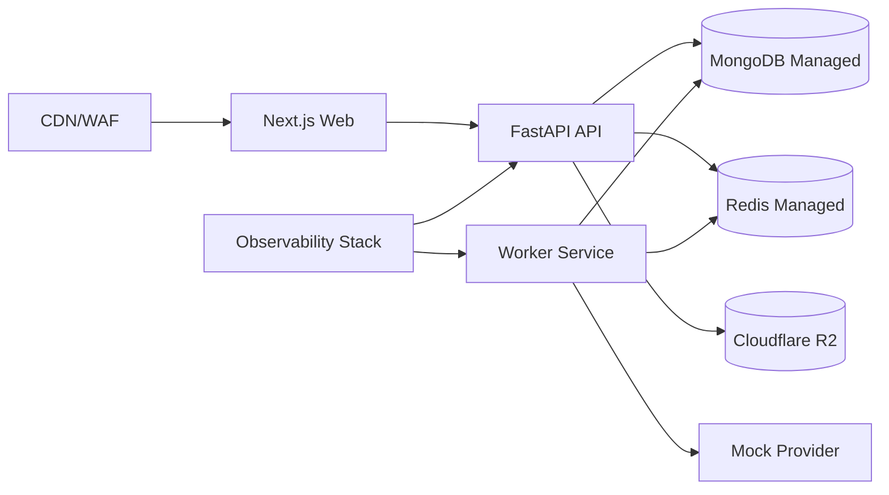

# Deployment Topology and DevOps Blueprint

## Target Production Topology

## Deployment Choices

### Option A (simple)

- Web: Vercel
- API + Worker: Railway/Render/Fly
- MongoDB Atlas + Upstash Redis
- Cloudflare R2

### Option B (self-managed)

- Kubernetes for web/api/worker
- Managed Mongo and Redis
- Cloudflare R2
- Ingress + cert-manager + HPA

## Infrastructure Concerns

- Horizontal scaling for worker consumers
- Sticky or stateless auth strategy (prefer stateless)
- Readiness and liveness checks on API/worker
- Centralized logs with request and job IDs

## Capacity Planning Baseline

- API: 2 replicas
- Worker: 2 replicas, concurrency 5 each
- Redis memory sized by queue depth and retry policy

## Observability Requirements

- Metrics: request latency, error rates, queue depth, publish success ratio
- Logs: structured JSON
- Traces: optional OpenTelemetry
- Alerts: failed publish spike, dead-letter growth, API 5xx rate
